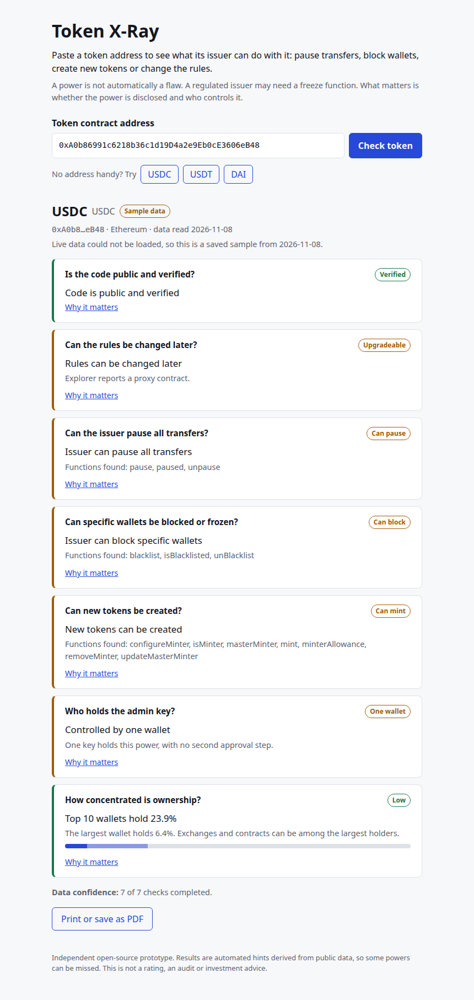
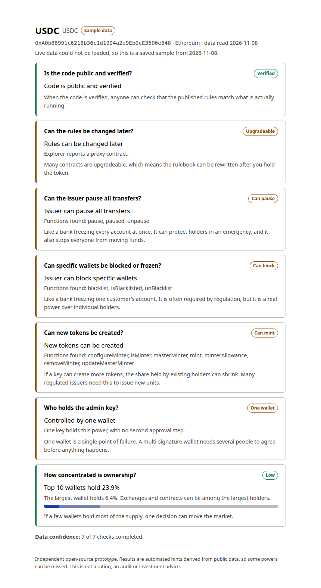

# Token X-Ray

Paste a token address and see what its issuer can do with it. Token X-Ray reads public Ethereum contract data and reports the powers and control structure behind a token: pausing, wallet freezing, minting, upgradeability, admin control, code verification and holder concentration.

**Live demo:** https://pikuz1.github.io/TokenXRay/

> Independent open-source prototype. Results are automated hints derived from public data. This is not a rating, an audit or investment advice, and it is not affiliated with any rating provider.



## Why

A tokenized asset's risk depends on more than what backs it. The contract itself decides who can pause transfers, block wallets, create new tokens or rewrite the rules. A power is not automatically a flaw: regulated issuers often need a freeze function. What matters is whether the power exists, who controls it and how it is governed. Token X-Ray makes those facts quick to check, and never labels a token good or bad.

## What it checks

| Check          | What it tells you                                          | How it is detected                                                            |
| -------------- | ---------------------------------------------------------- | ----------------------------------------------------------------------------- |
| Verified code  | Whether the published source matches the deployed contract | Explorer verification status (for proxies, both proxy and implementation)     |
| Upgradeable    | Whether the contract logic can be swapped later            | EIP-1967 implementation slot combined with the explorer's proxy information   |
| Pause power    | Whether all transfers can be halted                        | `pause` / `unpause` / `paused` in the ABI                                     |
| Freeze / block | Whether specific wallets can be blocked                    | Blacklist, blocklist, denylist, freeze and ban style functions                |
| Mint power     | Whether new tokens can be created                          | `mint` / minter style functions                                               |
| Admin control  | Single wallet, contract or multi-signature, with threshold | `owner()` lookup, contract check, Safe-style `getThreshold()` / `getOwners()` |
| Concentration  | Share of supply held by the largest wallet and the top 10  | Explorer top-holders data                                                     |

When something cannot be determined, the result says **Unknown** instead of guessing, and a data confidence line shows how many checks could run.

## Features

- A result card per check, with a one-line explanation of why it matters
- Data confidence summary (for example "7 of 7 checks completed")
- Staged loading: the quick checks appear first, and holder concentration fills in when the slow holder list arrives
- Printable / save-as-PDF report
- Bundled sample tokens (USDC, USDT, DAI) that double as an offline fallback
- Vendor-neutral event tracking layer with no third-party analytics



## Tech stack

- Nuxt 4, Vue 3, TypeScript (strict), static output
- [viem](https://viem.sh) for on-chain reads through a public RPC
- Blockscout public API for contract and holder data
- Vitest and Vue Test Utils for unit and component tests, with a 100% coverage threshold
- Playwright for end-to-end tests
- GitHub Actions for CI and GitHub Pages deployment

Everything runs on free, open tooling with no API keys.

## Getting started

```bash
git clone https://github.com/Pikuz1/TokenXRay.git
cd TokenXRay
npm install
npm run dev
```

Node 22 or newer is required.

## Scripts

```bash
npm run dev          # local development
npm run build        # production build
npm run generate     # static build for GitHub Pages
npm run lint
npm run format:check
npm run typecheck
npm test             # unit and component tests with coverage (fails below 100%)
npm run test:e2e     # Playwright
```

To build for a subpath such as GitHub Pages, set the base URL: `NUXT_APP_BASE_URL=/TokenXRay/ npm run generate`.

## Architecture

```
app/
  components/   result cards, address form, token header
  composables/  useTokenAnalysis (state and orchestration), useTracker
  content/      wording and presentation of each result
  data/         bundled sample analyses
  pages/        the single page
  utils/
    address.ts      address parsing and validation
    analytics.ts    tracker and sinks
    detectors/      pure functions: one per check, no I/O
    data/           explorer and RPC access with timeouts
    analysis/       combines the data layer and detectors
fixtures/     ABI fixtures used by tests
tests/unit/   Vitest, mirrors the app structure
tests/e2e/    Playwright journeys with mocked network responses
```

Detectors are pure functions over already-fetched data. The data layer is injected, so every part is testable without network access. Detectors match whole words in function names (so `addBlackList` matches `blacklist`, while `bankTransfer` does not match `ban`). Proxy contracts are analysed through their implementation's ABI; if that ABI is unavailable, the ABI-based checks report Unknown instead of guessing.

Concentration thresholds live in one file, [app/config/thresholds.ts](app/config/thresholds.ts), and are illustrative defaults.

## Testing

Unit tests cover detectors against fixture ABIs (powerful token, plain token, look-alike names, split-word names), the data layer with injected fetchers and clients, the analysis service, the composable, every component and the page. Coverage is enforced at 100% for statements, branches, functions and lines. End-to-end tests cover a sample-token walkthrough, a typed address, invalid input, the offline fallback, the explanation toggle and the print layout, on desktop and phone viewports. CI runs lint, formatting, type checks and all tests on every push.

## Limitations

- Detection is based on function names and public data, so some powers are missed and some matches can be false positives. For example, USDT creates tokens with an `issue` function, which is not recognised as minting.
- Admin control only looks at `owner()`. Contracts that use role-based access control are reported as having no single owner function.
- Ethereum mainnet only.
- Public RPC and explorer endpoints are rate-limited. Holder lists for large tokens can take 10 to 20 seconds to load. When the sources cannot be reached the app falls back to bundled sample data for the sample tokens.
- Holder lists can include exchanges and contracts, which affects concentration figures.
- Concentration thresholds are illustrative defaults.

## Roadmap

- Additional chains
- Unusual-activity markers on recent transfer volume
- Side-by-side token comparison
- Embeddable result widget

## Disclaimer

This project is for informational and demonstration purposes only. It does not provide ratings, audits, legal advice or investment advice, and results may be incomplete or incorrect.

## License

MIT
